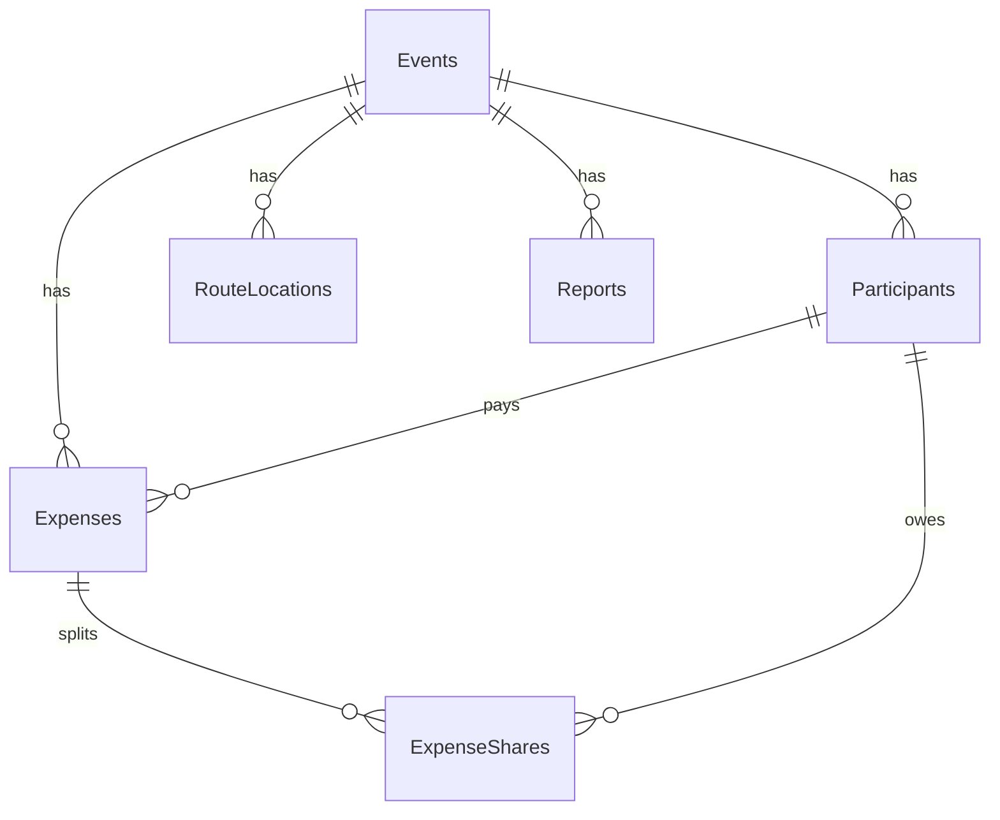

# Схема бази даних FairFare

## ER-діаграма


## Обмеження цілісності

| Обмеження | Де забезпечується |
| --- | --- |
| `TotalAmount > 0`, `OwedAmount >= 0` | CHECK у БД |
| Сума часток = `TotalAmount` | бізнес-логіка (`ValidateExpense`) |
| Платник і боржники з тієї ж події | бізнес-логіка |
| `(EventId, OrderIndex)` унікальна | унікальний індекс |
| Видалення події каскадно видаляє все | `ON DELETE CASCADE` |
| Учасника з витратами видалити не можна | `ON DELETE NO ACTION` для `PayerId`, `DebtorId` |

## Приклади SQL

Баланс учасників:
```sql
SELECT p."Name",
       COALESCE(paid.total, 0) - COALESCE(owed.total, 0) AS "Balance"
FROM "Participants" p
LEFT JOIN (SELECT "PayerId", SUM("TotalAmount") AS total
           FROM "Expenses" GROUP BY "PayerId") paid ON paid."PayerId" = p."Id"
LEFT JOIN (SELECT "DebtorId", SUM("OwedAmount") AS total
           FROM "ExpenseShares" GROUP BY "DebtorId") owed ON owed."DebtorId" = p."Id"
WHERE p."EventId" = @eventId;
```

Впорядкований маршрут:
```sql
SELECT "LocationName" FROM "RouteLocations"
WHERE "EventId" = @eventId ORDER BY "OrderIndex";
```
